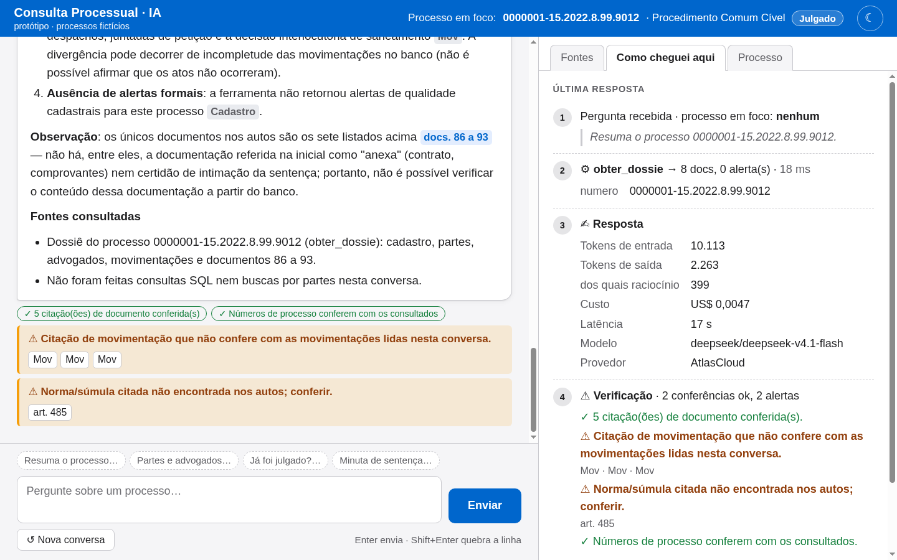

# Agente de Consulta Processual

Protótipo feito para o desafio "Agente de IA sobre dados estruturados" do TJSC/DTI, no processo seletivo para
Engenheiro de Produto de IA do Tribunal de Justiça de Santa Catarina. É um chat em português sobre o banco SQLite
sintético do desafio, com 10.000 processos fictícios. O agente entende a pergunta e decide sozinho como consultar o
banco. Ele cita a fonte de cada informação e mantém o foco em um processo ao longo da conversa. Quando os dados não
permitem afirmar algo, ele diz. A minuta de sentença sai sempre como proposta, nunca como sentença proferida.



*Resposta real do modelo, capturada na revisão ao vivo da interface. Abaixo dela ficam os selos da verificação
daquele momento: dois conferidos e dois alertas. Um alerta é de citações genéricas de movimentação. O outro diz que a
norma "art. 485" não foi encontrada nos autos. À direita, a aba "Como cheguei aqui" mostra a ferramenta chamada
(18 ms), os tokens, o custo (US$ 0,0047), a latência (17 s), o modelo e o provedor.*

| Documento | O que tem |
|---|---|
| [DECISOES.md](DECISOES.md) | decisões com evidência medida e as respostas às 5 perguntas da arguição |
| [docs/uso-de-ia.md](docs/uso-de-ia.md) | como a IA foi usada no desenvolvimento e onde atrapalhou |
| [docs/roteiro-demo.md](docs/roteiro-demo.md) | roteiro da demonstração, com plano B |
| [CLAUDE.md](CLAUDE.md) | convenções para quem continuar o projeto, pessoa ou IA |
| [spec](docs/superpowers/specs/2026-09-23-agente-consulta-processual-design.md), [plano](docs/superpowers/plans/2026-09-24-agente-consulta-processual.md) e [spike](docs/pesquisa/2026-09-23-spike-modelos/RESULTADOS.md) | design aprovado, plano em 21 tarefas e a pesquisa que escolheu o modelo |

## Requisitos

- **Python 3.12 ou mais novo, com SQLite 3.36 ou mais novo.** O SQL escrito pelo modelo roda numa cópia do banco em
  memória. Essa cópia usa a VFS `memdb`, que chegou no SQLite 3.36. O Python que o `uv` baixa e gerencia já atende.
  Um Python compilado contra um SQLite antigo do sistema não atende. Exemplo real: o 3.12.3 do pyenv, com SQLite
  3.31.1. Nesse caso, o app se recusa a subir e explica o motivo. A solução é `uv sync --managed-python`. O
  desenvolvimento e os testes rodaram em Python 3.14.6, e a suíte também foi validada em 3.12.13 gerenciado pelo
  uv. As duas versões têm SQLite 3.53.1.
- **[uv](https://docs.astral.sh/uv/)**, testado com a versão 0.11.28. A instalação está em [Como rodar](#como-rodar).
- **Chave do OpenRouter**, só para o chat e as avaliações. Os testes não usam chave nem rede.
- **Node.js** (opcional, testado com a v22.17.0) para o teste do núcleo JavaScript da interface. Sem Node, esse
  teste é pulado.

## Como rodar

O projeto roda no Linux e no Windows, sem WSL. Foi desenvolvido no Linux e testado também no Windows 11 com Python
3.12, onde o app sobe e os testes passam. Não é preciso instalar o Python à parte: se não houver um 3.12 ou mais novo
na máquina, o `uv` baixa um.

### Linux

1. Instale o `uv`:

   ```bash
   curl -LsSf https://astral.sh/uv/install.sh | sh
   ```

   Sem `curl`, use `wget -qO- https://astral.sh/uv/install.sh | sh`. Depois feche e abra o terminal, para o `uv`
   entrar no PATH.

2. Baixe o projeto e prepare o ambiente:

   ```bash
   git clone https://github.com/igorCapella/desafio-ia.git
   cd desafio-ia
   uv sync
   cp .env.example .env
   ```

3. Edite o `.env` e preencha `OPENROUTER_API_KEY`.
4. Suba o app:

   ```bash
   uv run uvicorn app.main:app
   ```

No macOS, os passos são os mesmos.

### Windows

Os comandos abaixo são para o PowerShell. O `git clone` precisa do [Git para Windows](https://git-scm.com/download/win).

1. Instale o `uv`:

   ```powershell
   powershell -ExecutionPolicy ByPass -c "irm https://astral.sh/uv/install.ps1 | iex"
   ```

   Outra opção é `winget install --id=astral-sh.uv -e`. Depois feche e abra o PowerShell, para o `uv` entrar no PATH.

2. Baixe o projeto e prepare o ambiente:

   ```powershell
   git clone https://github.com/igorCapella/desafio-ia.git
   cd desafio-ia
   uv sync
   Copy-Item .env.example .env
   ```

3. Edite o `.env` (por exemplo, com `notepad .env`) e preencha `OPENROUTER_API_KEY`.
4. Suba o app:

   ```powershell
   uv run uvicorn app.main:app
   ```

### Depois de subir

Abra <http://localhost:8000>. Na subida, o app confere o banco (o arquivo existe e tem as 7 tabelas esperadas) e
prepara a cópia de consulta do modelo. Qualquer problema interrompe a subida com mensagem em português.

As quatro sugestões da tela são os exemplos do desafio, já preenchidos com processos do banco.

O banco já vem no repositório, descompactado, em `data/desafio.sqlite` (41.811.968 bytes). Ele só é aberto em modo
leitura. Um teste confere o SHA-256 do arquivo (`8a90b47c…0c43`), provando que ele nunca foi alterado.

Os demais comandos deste README (testes, avaliações e resumo do log) são iguais no Linux e no Windows.

## Testes

```bash
uv run pytest            # 208 testes (202 em tests/ e 6 em evals/), sem chave e sem rede
uv run pytest -W error   # os mesmos testes, com avisos tratados como erro: também passa
node --test tests/web/nucleo.test.cjs   # 9 testes do núcleo JavaScript (o pytest também os roda se houver Node)
```

O `pyproject.toml` já passa `-q` ao pytest. Um segundo `-q` esconde a linha com o total.

A CI (`.github/workflows/testes.yml`) roda `uv sync` e `uv run pytest -q` em Python 3.12 a cada push e pull request,
sem chave de API.

## Avaliações com o modelo real

```bash
uv run python -m evals                  # rodada completa: 25 casos (16 críticos), com LLM-juiz
uv run python -m evals --sem-juiz       # só as checagens objetivas
uv run python -m evals --casos C01,C06  # só alguns casos
```

Nas três rodadas reais, cada rodada completa custou entre US$ 0,16 e US$ 0,18. A primeira levou cerca de 16 minutos.
O resultado sai em `evals/resultados/<AAAA-MM-DD_HHMM>.md`, com todas as respostas para leitura humana, e num `.json`
de mesmo nome. O relatório compara a rodada com a anterior. O comando termina com código 1 quando algum caso crítico
falha.

As avaliações chamam o agente direto, sem passar pela API. Por isso não entram no log de auditoria nem no teto
`ORCAMENTO_USD`. Confira o saldo da chave antes de rodar.

O teste `evals/test_smoke.py` roda junto com o `pytest`: ele confere os gabaritos dos 25 casos contra o banco, sem
chamar a API, e remonta todos os turnos de uma rodada gravada.

Na última rodada (24/09/2026, 16:47), os 25 casos passaram nas checagens objetivas, inclusive os 16 críticos. A
evolução das três rodadas, e o que cada uma revelou, está no [DECISOES.md](DECISOES.md) (pergunta 2).

### Reverificar as respostas gravadas, sem custo

```bash
uv run python -m evals.reverificar evals/resultados/2026-09-24_1647.json
```

O script refaz as consultas gravadas em cada turno e roda o verificador de hoje sobre a resposta gravada. Ele não
chama o modelo e leva cerca de meio segundo por rodada. Serve para medir o efeito de uma mudança no verificador sem
gastar uma rodada nova. Os relatórios `.md` gravados mostram os selos como eram na época. Com o verificador de hoje,
as três rodadas passam de 20, 18 e 7 alertas para 2, 7 e 4, todos verdadeiros.

## Log de auditoria

Cada pergunta feita pela interface vira uma linha em `logs/auditoria.jsonl`. A linha guarda a data e hora, a sessão, a
pergunta, a resposta e se era minuta, o processo em foco, as ferramentas (argumentos, SQL e duração), o modelo, o
provedor, os tokens, o custo, a latência, os selos e os erros. O log não guarda chaves, e todo CPF sai mascarado. Para
resumir:

```bash
uv run python scripts/resumo_logs.py   # custo total, latência p50/p95, selos, modelos e provedores
```

O log real vem dos testes ao vivo feitos nas revisões: 9 perguntas, US$ 0,0200 no total, latência p50 de 8,2 s e
p95 de 32,7 s.

## Configuração (`.env`)

O modelo do arquivo é o `.env.example`.

| Variável | Padrão | Uso |
|---|---|---|
| `OPENROUTER_API_KEY` | — | chave, obrigatória para o chat e as avaliações |
| `LLM_BASE_URL` | `https://openrouter.ai/api/v1` | qualquer endpoint compatível com a API da OpenAI; um vLLM on-premises entra aqui, sem mudar código |
| `LLM_MODEL` | `deepseek/deepseek-v4.1-flash` | modelo principal |
| `LLM_MODEL_RESERVA` | `deepseek/deepseek-v4-pro-0813` | reserva, que o OpenRouter usa se o principal falhar |
| `REASONING_EFFORT` | `high` | nível de raciocínio |
| `FORCE_IPV4` | `false` | `true` em máquinas com IPv6 quebrado (ver "Solução de problemas") |
| `ORCAMENTO_USD` | `3.0` | teto de gasto do app; no teto, novas perguntas são recusadas |
| `MASCARAR_CPF` | `true` | CPF mascarado nas visões, no log e nas respostas, salvo o que o próprio usuário digitou (LGPD) |
| `DB_PATH` | `data/desafio.sqlite` | banco |

## Arquitetura

O navegador envia a pergunta para `POST /api/chat` e recebe a resposta em streaming (SSE). O laço do agente
(`app/agente/ciclo.py`, sem framework) manda o histórico ao modelo e executa as ferramentas que ele pedir. O laço
devolve os resultados ao modelo até chegar à resposta final ou ao limite de 8 passos. As ferramentas leem visões
normalizadas do banco original, só em modo leitura. O SQL escrito pelo modelo roda numa cópia em memória que só tem
essas visões, com o CPF já mascarado. No fim do turno, a verificação confere a resposta contra o que foi de fato lido
na conversa e emite selos. O turno inteiro vai para o log de auditoria.

```
Navegador (HTML/JS sem build; marked e DOMPurify servidos localmente)
  │  POST /api/chat {sessao_id, pergunta}
  ▼  SSE: status · ferramenta · texto · processo · verificacao · fim · erro
API FastAPI (app/main.py): teto de orçamento, uma pergunta por vez em cada conversa
  │
  ▼
Laço do agente (app/agente/ciclo.py): sessão em memória com histórico, processo em foco e custo
  ├─ cliente LLM próprio (httpx) → OpenRouter → DeepSeek V4.1 Flash (high, fp8 ou mais preciso)
  └─ ferramentas (app/dados/ferramentas.py)
       ├─ obter_dossie, buscar_processos → visões normalizadas sobre data/desafio.sqlite (mode=ro)
       └─ consultar_sql → cópia em memória só com as 6 visões (CPF mascarado; tabela base não existe)
  │
  ▼
Verificação (app/verificacao): citações · aspas · normas · minuta · processo em foco · dados pessoais
  │
  ▼
Log de auditoria (logs/auditoria.jsonl): CPF mascarado, sem chaves
```

Por que cada peça é assim, e o que foi descartado, está no [DECISOES.md](DECISOES.md).

## Estrutura

```
app/
  main.py            API: /api/chat (SSE), /api/sessao/nova, /api/documento/{id}, /api/saude; serve a interface
  config.py          configuração lida do .env
  auditoria.py       log de auditoria (jsonl)
  agente/            ciclo.py (laço) · llm.py (cliente) · sessao.py (histórico e foco) · prompt.md (prompt de sistema)
  dados/             conexao.py · visoes.py · alertas.py · ferramentas.py · numero_cnj.py
  verificacao/       citacoes.py · aspas.py · normas.py · minuta.py · processo.py · dados_pessoais.py · selos.py
  web/static/        index.html · app.js · nucleo.js (funções puras, testadas) · estilo.css · vendor/
data/desafio.sqlite  banco original do desafio, versionado descompactado
evals/               casos.yaml · rubrica.md · executar.py · reverificar.py · resultados/
scripts/             resumo_logs.py
tests/               testes pytest; tests/web/ tem o teste do núcleo JS
docs/                uso-de-ia.md · roteiro-demo.md · img/ · pesquisa/ · superpowers/ (spec, plano e mockups)
```

## Solução de problemas

- **As chamadas ao modelo travam até o timeout.** Em máquinas com IPv6 quebrado, clientes HTTP em Python podem
  travar esperando a conexão. Foi o que aconteceu no WSL2 da máquina de desenvolvimento. Ponha `FORCE_IPV4=true` no
  `.env` e reinicie o app.
- **O app não sobe: "Este Python usa SQLite …; a base de consulta do modelo precisa de SQLite 3.36 ou mais novo".**
  Rode `uv sync --managed-python` para usar um Python gerenciado pelo uv.
- **"Orçamento do protótipo atingido; novas perguntas estão suspensas."** O gasto acumulado, recalculado a partir do
  log de auditoria, chegou ao `ORCAMENTO_USD`. Para continuar, aumente o valor no `.env` e reinicie. Não apague o
  log: ele é a trilha de auditoria.
- **"Não foi possível obter a resposta do modelo agora. Tente de novo."** A chave está ausente ou inválida, ou o
  provedor falhou depois de 3 tentativas. O detalhe técnico fica no campo `erros` do log de auditoria.
- **"Banco não encontrado em …"** Confira o `DB_PATH` no `.env`.
- **Porta 8000 ocupada.** Use `uv run uvicorn app.main:app --port 8001`.
